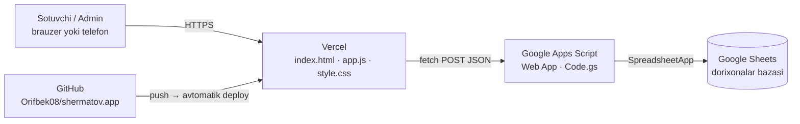

# Др. Шерматов — dorixonalar tarmog'i · platforma hujjati

> Holat: 10.11.2026 · Sayt: **app.js v3 / style.css v3** · Server: **Code.gs v3 (SCHEMA 3)**
> Sayt: **https://shermatovapp.vercel.app** · Baza: **«Др Шерматов аптека»** Google Sheets
> Kod: **GitHub → `Orifbek08/shermatov.app`** (main)

Ilova matni 100% kirillda; bu hujjat lotinda, varaq/ustun/tugma nomlari ilovadagidek kirillda berilgan.

---

## 1. Umumiy ko'rinish

5 ta filial (dorixona) uchun **Приход, Расход (sotuv), filialdan filialga Ўтказма, Қолдиқ, Тарих, Ҳисобот**.
**Yagona ma'lumotlar bazasi — bitta Google Sheets jadvali.** Alohida server yoki pullik baza yo'q.

| Qism | Qayerda | Nima qiladi |
|---|---|---|
| **Sayt** (`index.html`, `app.js`, `style.css`) | GitHub → Vercel | Interfeys |
| **Server** (`Code.gs`) | Sheets ichidagi Apps Script, «Web App» | O'qish/yozish, qoldiq hisobi, ruxsatlar, token |
| **Ma'lumot** | Google Sheets | Hamma harakatlar, mahsulotlar, filiallar, vrachlar, foydalanuvchilar |

Oddiy HTML/CSS/JS — framework, build yoki `npm` kerak emas.

---

## 2. Birinchi o'rnatish (bir marta)

1. Google Drive'da **yangi bo'sh Google Sheets** yarating (nomi ixtiyoriy, masalan «Др. Шерматов — база»).
2. **Extensions → Apps Script**. Ichidagi kodni to'liq o'chirib, `Code.gs`ni qo'ying, 💾 saqlang.
3. **Deploy → New deployment → ⚙ Web app**:
   *Execute as:* **Me**, *Who has access:* **Anyone** → **Deploy** → Google ruxsat so'raydi → **Allow**.
4. Berilgan **Web app URL**ni (`https://script.google.com/macros/s/…/exec`) nusxalang.
5. Shu manzilni brauzerda oching → `{"ok":true,"app":"shermatov","v":"1"}` chiqadi.
   **Shu paytda jadvalning hamma varaqlari o'zi yaratiladi** (81 ta mahsulot — Jadval.xlsx'dan, 5 ta filial, foydalanuvchilar bilan).
6. Sheets sahifasini yangilang — tepada **«Дорихона»** menyusi paydo bo'ladi.
7. Manzilni saytga ulash (✅ qilingan: `app.js` → `DEFAULT_API_URL`) — ikki yo'l:
   - `app.js` boshidagi `DEFAULT_API_URL = ''` ga manzilni yozib GitHub'ga push qiling (hamma qurilmada o'zi ishlaydi), **yoki**
   - saytning kirish sahifasida **⚙ Сервер манзили** ni bosib, manzilni qo'ying (faqat shu qurilmada saqlanadi).

---

## 3. Google Sheets varaqlari

Varaqlar va ustunlar **o'zi yaratiladi**. Eski ma'lumot o'chirilmaydi, faqat yetishmagani qo'shiladi.

### 3.1. Ma'lumot varaqlari

| Varaq | Nima saqlanadi |
|---|---|
| **Ҳаракатлар** | **Hamma harakat bitta joyda**: Приход, Расход, Ўтказма. Ustunlar: Ҳужжат №, Сана, Вақт, Тури, Филиал, Маҳсулот, Сони, Нарх, Сумма, Мижоз Ф.И.Ш, Юборган врач, Қаерга (o'tkazmada), Ҳолат, Оператор, Изоҳ |
| **Қолдиқ** | Mahsulot × filial jadvali, Жами, Минимал. Har yozuvdan keyin server o'zi yangilaydi. Sariq — minimalga yetgan, qizil — tugagan |
| **1-филиал … 5-филиал** | Har filialning **o'z varag'i**: shu filialning hamma harakati, kirgan o'tkazmalar ham. Formula emas — server har yozuvni Ҳаракатлар'ga va shu varaqqa birga yozadi. Qo'lda yozilmaydi |

Bitta hujjatda bir nechta mahsulot bo'lsa — har mahsulot alohida qator, Ҳужжат № bir xil.
Ҳужжат № prefiksi: **С** — сотув (расход), **П** — приход, **Ў** — ўтказма.

### 3.2. Sozlama varaqlari (shu yerda o'zgartirasiz — saytga o'zi tushadi)

| Varaq | Ustunlar | Izoh |
|---|---|---|
| **Маҳсулотлар** | Маҳсулот, Нарх, Бирлик, Минимал қолдиқ, Изоҳ | 81 ta mahsulot (Jadval.xlsx). Nomida hajmi qavsda: «Qora Yong'oq (500gr)». **Нарх bo'sh — o'zingiz yozasiz**; yozilsa sotuvda avtomatik qo'yiladi, yozilmasa sotuvchi har safar kiritadi. Минимал (3) — shundan kam qolsa ogohlantiradi. Yangi mahsulot — shu varaqqa yangi qator |
| **Филиаллар** | Филиал, Манзил, Телефон | Boshlang'ich: 1-филиал … 5-филиал. **Ishlatishdan oldin haqiqiy nomlarni yozing** |
| **Докторлар** | Врач, Изоҳ | Sotuvda yangi vrach yozilsa, bu yerga o'zi qo'shiladi |
| **Фойдаланувчилар** | Исм, PIN, Роль, Филиал | `админ` — hammasini ko'radi. `сотувчи` — faqat o'z filiali (Филиал ustuni majburiy) |
| **Созламалар** | Тармоқ номи, Валюта | Saytning tepasida chiqadigan nom |

Boshlang'ich PIN'lar: **Админ 1234**, Сотувчи 1…5 → **1111, 2222, 3333, 4444, 5555**. ⚠ **Albatta almashtiring.**

> ⚠ Filial yoki mahsulot nomini **ishlatilgandan keyin o'zgartirmang** — eski yozuvlarda eski nom qoladi va qoldiq ikkiga bo'linadi. Nom o'zgartirilsa: «Дорихона → Қолдиқ ва филиал варақларини қайта ҳисоблаш».

### 3.3. «Дорихона» menyusi

| Band | Nima qiladi |
|---|---|
| Ўрнатиш / янгилаш (варақлар) | Hamma varaq/ustunni tekshiradi, yetishmaganini yaratadi (yangi filial qo'shilsa — uning varag'i ham) |
| Қолдиқ ва филиал варақларини қайта ҳисоблаш | Қолдиқ va filial varaqlarini Ҳаракатлар'dan noldan qayta yozadi (Ҳаракатлар qo'lda tuzatilgandan keyin) |
| Кешни тозалаш | O'zgarishlar saytga darhol tushadi (odatda kerak emas — sozlama varaqlari tahrirlansa kesh o'zi tozalanadi) |
| ⚠ Синов маълумотларини тозалаш | Avval **zaxira nusxa** yaratadi, keyin hamma harakatlarni o'chiradi. Sozlamalar qoladi. Tasdiq: `1234` |

---

## 4. Sayt bo'limlari

| Bo'lim | Kim | Vazifasi |
|---|---|---|
| **Сотув** (расход) | hamma | **Мижоз Ф.И.Ш** (majburiy), **Юборган врач** (ro'yxatdan yoki yangi), mahsulotlar (nomini yozib qidiriladi): **сони, нарх, сумма** (summasiz sotib bo'lmaydi). Qoldiqdan ko'p sotib bo'lmaydi. O'ngda — bugungi sotuvlar |
| **Приход** | hamma | Mahsulot va **сони** (summa yo'q). Qoldiqqa qo'shiladi |
| **Ўтказма** | hamma | O'z filialidan → boshqa filialga, mahsulot va сони. Qabul qiluvchi filialdagi qoldiq ham ko'rinadi |
| **Қолдиқ** | hamma | Hamma filiallar qoldig'i (sotuvchi qayerdan so'rashni biladi). «Кам қолган» ro'yxati — qaysi filialda ortig'i borligini ko'rsatadi |
| **Тарих** | hamma (sotuvchi — o'z filiali) | Бугун / Кеча / 7 кун / Шу ой / Ўтган ой / ixtiyoriy davr, tur, qidiruv. Bekor qilish |
| **Ҳисобот** | admin | Sotuv summasi, cheklar, dona, mijozlar; filiallar, mahsulotlar, **yuborgan vrachlar**, mahsulot × filial, kunlar bo'yicha. A4 chop etish |

**Admin** tepada filialni tanlaydi: «Ҳамма филиаллар» — hammasini ko'rish; aniq filial — shu filial nomidan yozish.

### Qoidalar
- **Sotuv:** narx mahsulotdan avtomatik qo'yiladi, summa = сони × нарх. Summani qo'lda o'zgartirish mumkin (chegirma) — maydon sariq bo'ladi.
- **Qoldiq manfiy bo'lmaydi:** sotuv va o'tkazma qoldiqdan oshsa server rad etadi.
- **Bekor qilish** yozuvni o'chirmaydi — `Ҳолат = Бекор`, sababi Изоҳ'ga yoziladi, qoldiq qaytadi. Sotuvchi faqat **o'z filialining bugungi** hujjatini bekor qiladi; admin — istalganini. Приход/ўтказмani bekor qilish qoldiqni manfiy qilsa (tovar allaqachon sotilgan) — rad etiladi.

---

## 5. Kirish va xavfsizlik
- Kirish **PIN** bilan. Server **30 kunlik token** beradi (HMAC-SHA256). PIN o'zgartirilsa eski tokenlar darhol bekor bo'ladi.
- Sotuvchi boshqa filial nomidan yoza olmaydi — bu **serverda** tekshiriladi. Ҳисобот faqat admin uchun (serverda ham).
- Har bir yozuvda `rid` bor — tugma ikki marta bosilsa yoki internet uzilib qayta yuborilsa ham bir marta yoziladi.
- Yozuvlar `LockService` bilan navbatga qo'yiladi — ikki sotuvchi bir vaqtda sotsa ham qoldiq to'g'ri.

---

## 6. Code.gs ni yangilash
1. Sheets → **Extensions → Apps Script** → eski kodni to'liq o'chirib yangisini qo'ying, 💾. Loyihada **faqat bitta** `.gs` fayl.
2. **Deploy → Manage deployments → ✏️ → Version: New version → Deploy.**
   ⚠ «New deployment» **bosilmasin** — manzil o'zgaradi.
3. Web App manzilini oching → `"v"` raqami yangisi bo'lishi kerak.

Sayt fayllari o'zgarsa — `index.html` dagi `style.css?v=1`, `app.js?v=1` raqami oshiriladi.

---

## 7. Muammolar
| Belgisi | Nima qilish kerak |
|---|---|
| «Сервер жавоби нотўғри» | Apps Script'da bitta `Code.gs` → New version → Deploy |
| «Сеанс тугади — қайта киринг» | PIN o'zgargan yoki 30 kun o'tgan — qayta kiring |
| Yangi narx/mahsulot chiqmayapti | «Дорихона → Кешни тозалаш» |
| Qoldiq yoki filial varag'i noto'g'ri | «Дорихона → Қолдиқ ва филиал варақларини қайта ҳисоблаш» |
| Sayt eski ko'rinishda | Ctrl+Shift+R |

**Qo'lda o'zgartirmang:** Ҳаракатлар'dagi Ҳужжат №, filial varaqlari va Қолдиқ (server o'zi yozadi).

---

## 8. Keyingi g'oyalar
1. Sotuv cheki (80 mm termoprinter).
2. Mijozlar bazasi: ism yozilganda avvalgi xaridlari, «доимий мижоз».
3. O'tkazmani qabul qiluvchi filial **tasdiqlashi** (yo'ldagi tovar).
4. Тўлов тури (Нақд / Карта / Click) va kassa.
5. Vrachlarga ulush (%) va oylik hisob-kitob.
6. Kunlik hisobot Telegram'ga.
7. Yaroqlilik muddati va partiya bo'yicha hisob.
