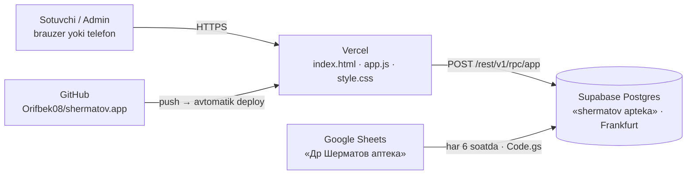

# Др. Шерматов — dorixonalar tarmog'i · platforma hujjati

> Holat: 10.11.2026 · Sayt: **app.js v6 / style.css v6** · Baza: **Supabase «shermatov apteka»** · Sheets nusxasi: **Code.gs v4**
> Sayt: **https://shermatovapp.vercel.app** · Kod: **GitHub → `Orifbek08/shermatov.app`** (main)

Ilova matni 100% kirillda; bu hujjat lotinda, tugma/bo'lim nomlari ilovadagidek kirillda.

---

## 1. Umumiy ko'rinish

5 ta filial uchun **Сотув (расход), Приход, Ўтказма, Қолдиқ, Тарих, Ҳисобот** va admin uchun **Созламалар**.
**Asosiy baza — Supabase (Postgres).** Google Sheets — har 6 soatda olinadigan **nusxa** (ko'rish va zaxira uchun).

| Qism | Qayerda | Nima qiladi |
|---|---|---|
| **Sayt** | GitHub → Vercel | Interfeys. Har amal Supabase'dagi bitta funksiyaga yuboriladi |
| **Baza + server mantig'i** | Supabase, `apteka` sxemasi | Jadvallar, qoldiq, PIN/token, hamma amallar — **har biri bitta tranzaksiyada** |
| **Sheets nusxasi** | Google Sheets ichidagi Apps Script (`Code.gs` v4) | Har 6 soatda Supabase'dan hammasini olib varaqlarga yozadi |

Tezlik: har so'rov ~0,1–0,3 soniya (Apps Script'da 1–3 soniya edi). Boshqa filialdagi o'zgarish 15 soniya ichida ko'rinadi.

---

## 2. Supabase

- Loyiha: **shermatov apteka** (`hfrfskwglwnbcaymzbad`), region **eu-central-1 (Frankfurt)**, tashkilot **threeHS**, tarif **Free**.
- Saytdagi kalit — **publishable** (ochiq). U bilan faqat `public.app(req jsonb)` funksiyasini chaqirish mumkin; `apteka` sxemasidagi jadvallarga to'g'ridan-to'g'ri kirib bo'lmaydi (RLS yoqilgan, sxema API'ga ochilmagan).
- `public.app` har so'rovda **PIN tokenini** tekshiradi, sotuvchiga faqat o'z filialini beradi, admin amallarini (Ҳисобот, Созламалар) faqat adminga ruxsat qiladi.
- SQL kodi repoda: `supabase/01_schema.sql`, `02_functions.sql`, `03_grants.sql`.

### Jadvallar (`apteka` sxemasi)

| Jadval | Nima |
|---|---|
| `products` | Маҳсулотлар: nom, narx, birlik, minimal qoldiq, faol |
| `branches` | Филиаллар: nom, manzil, telefon, faol |
| `doctors` | Врачлар (sotuvda yangi vrach yozilsa o'zi qo'shiladi) |
| `users` | Foydalanuvchilar: ism, **PIN (shifrlangan, bcrypt)**, rol, filial |
| `sessions` | Kirish tokenlari (30 kun). PIN o'zgarsa — o'chiriladi |
| `docs` / `doc_lines` | Hujjatlar (С-…, П-…, Ў-…) va ularning qatorlari |
| `stock` | Qoldiq: filial × mahsulot (har amalda qulflab yangilanadi) |
| `settings` | Tarmoq nomi, valyuta, Sheets eksport kaliti |

Mahsulot va filial **ID bilan** bog'langan — nomini o'zgartirish xavfsiz, eski yozuvlar yangi nom bilan ko'rinadi.

### Free tarif haqida
- 500 MB joy — yillarga yetadi.
- **1 hafta umuman ishlatilmasa loyiha uxlab qoladi** (Supabase panelidan bir tugma bilan uyg'otiladi). Har kuni ishlatilsa muammo yo'q.
- Avtomatik zaxira cheklangan — shuning uchun Sheets nusxasi muhim.

---

## 3. Google Sheets nusxasi (Code.gs v4)

Jadval: **«Др Шерматов аптека»**. Varaqlar: Ҳаракатлар, Қолдиқ, 1-филиал … 5-филиал, Маҳсулотлар, Филиаллар, Докторлар, Фойдаланувчилар (**PIN'siz**), Созламалар (oxirgi nusxa vaqti).

⚠ **Jadval — faqat nusxa.** Bu yerdagi o'zgarish saytga tushmaydi va keyingi nusxada ustidan yoziladi. Varaqlar «ogohlantirish» bilan himoyalangan.

**O'rnatish (bir marta):**
1. Jadval → **Extensions → Apps Script** → eski kodni to'liq o'chirib, yangi `Code.gs`ni qo'ying, 💾.
   (Eksport kaliti yozilgan nusxa alohida beriladi — GitHub'dagi faylda `__EXPORT_KEY__` turadi.)
2. Jadvalni yangilang → menyu **Дорихона → Ҳар 6 соатда нусха олишни ёқиш** → Google ruxsat so'raydi → Allow.
3. Shu zahoti birinchi nusxa yoziladi, keyin har 6 soatda o'zi.

Menyu: **Ҳозир нусха олиш** (qo'lda) · **Ҳар 6 соатда … ёқиш** · **Автоматик нусхани ўчириш**.
Eski Web App deploy'i endi kerak emas (eski sayt nusxasi unga murojaat qilsa «sahifani yangilang» deb javob beradi).

---

## 4. Sayt bo'limlari

| Bo'lim | Kim | Vazifasi |
|---|---|---|
| **Сотув** | hamma | Мижоз Ф.И.Ш (majburiy), Юборган врач, mahsulotlar (nomini yozib qidiriladi): сони (− / +), нарх, сумма |
| **Приход** | hamma | Mahsulot va сони (summa yo'q) |
| **Ўтказма** | hamma | O'z filialidan → boshqa filialga; qabul qiluvchidagi qoldiq ham ko'rinadi |
| **Қолдиқ** | hamma | Hamma filiallar qoldig'i, «kam qolgan» ro'yxati |
| **Тарих** | hamma (sotuvchi — o'z filiali) | Davr, tur, qidiruv, bekor qilish |
| **Ҳисобот** | admin | Filiallar, mahsulotlar, vrachlar, kunlar bo'yicha; A4 chop etish |
| **Созламалар** | admin | **Маҳсулотлар** (narxni jadvalning o'zida yozib Enter), **Филиаллар**, **Врачлар**, **Фойдаланувчилар** (rol, filial, PIN), **Умумий** (tarmoq nomi, valyuta) |

Telefonda Созламалар — yuqoridagi ⚙ tugmasi orqali.

### Qoidalar
- Qoldiq manfiy bo'lmaydi — sotuv va o'tkazma qoldiqdan oshsa rad etiladi (bir vaqtda sotilsa ham, qator qulflanadi).
- Bekor qilish yozuvni o'chirmaydi: `Бекор`, sababi saqlanadi, qoldiq qaytadi. Sotuvchi — faqat o'z filialining bugungi hujjatini; admin — istalganini.
- O'chirish o'rniga **«Фаол» belgisini olib tashlash**: mahsulot/filial/vrach ro'yxatdan yashirinadi, tarixi qoladi. Qoldig'i bor filialni o'chirib bo'lmaydi.
- PIN: 4–12 raqam, ikki foydalanuvchida bir xil bo'lmaydi. Kamida bitta faol admin qoladi.

---

## 5. Kirish va xavfsizlik
- PIN bilan kirish → 30 kunlik token. PIN o'zgarsa yoki foydalanuvchi o'chirilsa — hamma qurilmadan chiqariladi.
- Noto'g'ri PIN'dan keyin javob sekinlashtirilgan. **Tavsiya:** boshlang'ich PIN'larni (1234, 1111 …) almashtiring, imkon bo'lsa 6 raqamli qiling.
- Har yozuvda `rid` — tugma ikki marta bosilsa ham bir marta yoziladi.

---

## 6. Yangilash
- **Sayt:** GitHub'ga push → Vercel o'zi yangilaydi. Fayl o'zgarsa `index.html` dagi `?v=` raqami oshiriladi.
- **Baza mantig'i:** `supabase/02_functions.sql` o'zgartirilib Supabase'ga qo'llanadi (migration).
- **Sheets nusxasi:** `Code.gs` Apps Script'ga qo'lda qo'yiladi.

## 7. Muammolar
| Belgisi | Nima qilish kerak |
|---|---|
| «Интернет ёки сервер билан алоқа йўқ» | Internetni tekshiring; Supabase loyihasi uxlab qolgan bo'lsa — panelda **Restore** |
| «Сеанс тугади — қайта киринг» | PIN o'zgargan yoki 30 kun o'tgan |
| Sayt eski ko'rinishda / «Тизим янгиланди» | Ctrl+Shift+R |
| Sheets eskirgan | Дорихона → Ҳозир нусха олиш; Созламалар varag'ida «Охирги нусха» vaqti |

## 8. Keyingi g'oyalar
Sotuv cheki (80 mm) · mijozlar bazasi va «доимий мижоз» · o'tkazmani qabul qiluvchi tasdiqlashi · to'lov turi (naqd/karta) · vrach ulushi · kunlik hisobot Telegram'ga · yaroqlilik muddati.
